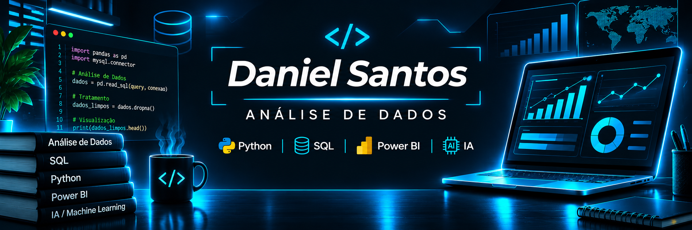

  

---

## 👋 Sobre mim

Sou formado em Desenvolvimento Full Stack pela Estácio e atualmente curso Inteligência Artificial e Machine Learning pela UniCesumar.

Estou direcionando minha trajetória profissional para a área de **Análise de Dados**, desenvolvendo conhecimentos em Python, SQL, Power BI e bancos de dados.

Gosto de aprender na prática, explorar tecnologias e desenvolver projetos que envolvam resolução de problemas, organização de informações e análise de dados.

Meu objetivo é conquistar uma oportunidade na área de Dados, aplicar meus conhecimentos e continuar evoluindo profissionalmente.

---

## 🎯 Meu foco atual

- 📊 Análise e interpretação de dados.
- 🗄️ Modelagem, consultas e manipulação de bancos de dados.
- 🐍 Programação com Python.
- 📈 Criação de dashboards e visualização de dados.
- 🤖 Aplicações de Inteligência Artificial e Machine Learning.
- 💻 Desenvolvimento de projetos práticos para meu portfólio.

---

## 🛠️ Tecnologias e ferramentas

**Programação e análise**

  
  

**Dados e visualização**

  
  

**Ferramentas**

  
  
  
  

---

## 📂 Projetos

Aqui compartilho meus projetos de desenvolvimento, estudos e evolução na área de tecnologia.

### 📌 Próximos projetos
- Modelagem e análise de dados com SQL.
- Análise exploratória de dados com Python.
- Dashboard interativo com Power BI.

---

## 📚 Formação

- 🎓 Tecnólogo em Desenvolvimento Full Stack — Estácio.
- 🎓 Inteligência Artificial e Machine Learning — UniCesumar (em andamento).

---

## 📫 Contato

  

  

